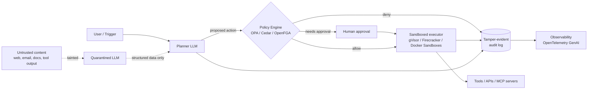

  <picture>
    <source media="(prefers-color-scheme: dark)" srcset="assets/logo-horizontal-dark.svg">
    
  </picture>

# Fencing Token: The AI Agent Security Roadmap

**Systems that can say no.**

> A curated, opinionated, and weekly-updated roadmap for engineers who build AI agents that can be **trusted, contained, and audited**.

AI agents now read email, browse the web, call APIs, write code, and move money. Most of them ship with the security model of a demo. This roadmap is the path from "it works on my laptop" to "we can prove what it did, why, and that it could not have done worse."

**Why "Fencing Token"?** In distributed systems, a [fencing token](https://martin.kleppmann.com/2016/02/08/how-to-do-distributed-locking.html) is a number that increases every time a lock is granted. The storage layer rejects any write carrying an older token, so a process whose authority has gone stale can never act on it. That is the whole idea behind this project: authority is checked where the action happens, by a system that can say no, not by the actor that wants to proceed. AI agents are the first series; the principle applies to any system that acts. (Not a cryptocurrency.)

**Maintained by [Anuj Ashok Potdar](https://www.linkedin.com/in/potdaranuj/)** · IEEE Senior Member · Author (Wiley-IEEE, Springer) · Manning Technical Reviewer
**Community:** Fencing Token · New entries every week · [Contribute](CONTRIBUTING.md) · **Website:** [anizmo.github.io/fencing-token](https://anizmo.github.io/fencing-token/)

⭐ Star the repo to follow weekly updates.

---

## Contents

- [The fenced agent in one picture](#the-fenced-agent-in-one-picture)
- [The roadmap](#the-roadmap)
  - [Stage 0: Threat modeling foundations](#stage-0-threat-modeling-foundations)
  - [Stage 1: Prompt injection and goal hijack](#stage-1-prompt-injection-and-goal-hijack)
  - [Stage 2: Isolation and sandboxing](#stage-2-isolation-and-sandboxing)
  - [Stage 3: Identity, authorization, and policy enforcement](#stage-3-identity-authorization-and-policy-enforcement)
  - [Stage 4: MCP and the tool supply chain](#stage-4-mcp-and-the-tool-supply-chain)
  - [Stage 5: Runtime guardrails](#stage-5-runtime-guardrails)
  - [Stage 6: Audit, observability, and provenance](#stage-6-audit-observability-and-provenance)
  - [Stage 7: Red teaming and benchmarks](#stage-7-red-teaming-and-benchmarks)
  - [Stage 8: Governance and standards](#stage-8-governance-and-standards)
- [Incidents worth studying](#incidents-worth-studying)
- [Learn and practice](#learn-and-practice)
- [The fenced agent production checklist](#the-fenced-agent-production-checklist)
- [Weekly updates](#weekly-updates)

---

## The fenced agent in one picture

Every serious agent architecture eventually converges on the same idea: **the model proposes, the system disposes.** The LLM never holds the keys. A deterministic layer decides what is allowed, a sandbox limits the blast radius, and a tamper-evident log records everything.

Three rules this roadmap keeps coming back to:

1. **Break the lethal trifecta.** Never let one agent context hold private data, untrusted content, *and* an exfiltration channel at the same time.
2. **Enforce outside the model.** Policies live in code that the model cannot talk its way past.
3. **If it isn't logged, it didn't happen.** Every prompt, retrieval, tool call, decision, and approval is recorded so it can be replayed and verified.

---

## The roadmap

### Stage 0: Threat modeling foundations

Start here. Learn the vocabulary and the shape of the risk before touching tools.

- [The lethal trifecta for AI agents](https://simonwillison.net/2025/Jun/16/the-lethal-trifecta/) (Simon Willison). The single most useful mental model: private data + untrusted content + external communication = data theft.
- [OWASP Top 10 for Agentic Applications (2026)](https://genai.owasp.org/resource/owasp-top-10-for-agentic-applications/). Peer-reviewed list of the ten biggest agent risks, ASI01 (Agent Goal Hijack) through ASI10, built from real 2025 incidents.
- [OWASP Top 10 for LLM Applications](https://genai.owasp.org/llm-top-10/). The model-layer companion list (prompt injection, sensitive data disclosure, excessive agency, and more).
- [OWASP Agentic AI: Threats and Mitigations](https://genai.owasp.org/resource/agentic-ai-threats-and-mitigations/). Deeper threat taxonomy for agent memory, tools, and multi-agent systems.
- [MITRE ATLAS](https://atlas.mitre.org/). ATT&CK-style knowledge base of real adversary tactics against AI systems. The [v2026.09 release](https://github.com/mitre-atlas/atlas-data/releases/tag/v2026.09) added techniques for agent recon, trigger channels, and crafted AI assistant links.
- [Google Secure AI Framework (SAIF)](https://saif.google/). Practitioner framework and risk self-assessment for AI systems.

### Stage 1: Prompt injection and goal hijack

The defining vulnerability of agents. You cannot patch it away; you design around it.

- [Prompt injection series](https://simonwillison.net/series/prompt-injection/) (Simon Willison). The running history of the problem, from the person who named it.
- [Not what you've signed up for: Indirect Prompt Injection](https://arxiv.org/abs/2302.12173) (Greshake et al.). The paper that showed retrieved content can hijack LLM-integrated apps.
- [Design Patterns for Securing LLM Agents against Prompt Injections](https://arxiv.org/abs/2506.08837). Six concrete patterns (plan-then-execute, dual LLM, action selector, and more) with trade-offs.
- [CaMeL: Defeating Prompt Injections by Design](https://arxiv.org/abs/2503.18813) (Google DeepMind and ETH Zurich). Separates control flow from untrusted data and enforces capabilities at tool-call time. [Code](https://github.com/google-research/camel-prompt-injection) (research prototype).
- [Agents Rule of Two and The Attacker Moves Second](https://simonwillison.net/2025/Nov/2/new-prompt-injection-papers/). Why adaptive attackers break most published defenses, and a simple rule for agent design.
- [Embrace The Red](https://embracethered.com/blog/) (Johann Rehberger). The best ongoing source of real-world agent exploit write-ups.

### Stage 2: Isolation and sandboxing

Assume the agent will be tricked. Make sure that when it is, it can only break a disposable box.

- [Docker Sandboxes](https://docs.docker.com/ai/sandboxes/). Disposable, isolated environments built for coding agents, each with its own Docker daemon, filesystem, and network, now with microVM isolation.
- [gVisor](https://gvisor.dev/). User-space kernel that intercepts syscalls; strong isolation for untrusted agent code without full VMs.
- [Firecracker](https://firecracker-microvm.github.io/). Lightweight microVMs (the tech behind AWS Lambda) for per-task isolation.
- [Kata Containers](https://katacontainers.io/). Containers that run inside lightweight VMs, so you keep the container workflow with VM-grade boundaries.
- [E2B](https://github.com/e2b-dev/E2B). Open-source cloud sandboxes purpose-built for running AI-generated code.
- [NsJail](https://github.com/google/nsjail). Google's lightweight process isolation using Linux namespaces, cgroups, and seccomp.
- [Wasmtime](https://wasmtime.dev/). WebAssembly runtime for capability-based, deny-by-default execution of tools and plugins.
- [Smokescreen](https://github.com/stripe/smokescreen). Stripe's egress proxy; block agents from reaching internal networks and cloud metadata endpoints.

### Stage 3: Identity, authorization, and policy enforcement

The core of "auditable": every action an agent proposes is checked by a deterministic policy, on behalf of a specific identity.

- [Open Policy Agent (OPA)](https://www.openpolicyagent.org/). General-purpose policy engine; write Rego rules that gate agent tool calls.
- [Cedar](https://cedarpolicy.com). Fast, analyzable authorization language; policies can be formally verified.
- [OpenFGA](https://openfga.dev/). Relationship-based (Zanzibar-style) fine-grained authorization, ideal for "can this agent read this document for this user?"
- [SpiceDB](https://github.com/authzed/spicedb). Open-source Zanzibar-inspired permissions database.
- [MCP Authorization specification](https://modelcontextprotocol.io/specification/latest/basic/authorization). How MCP servers act as OAuth resource servers; required reading if your agents call tools on a user's behalf.
- [OWASP Agent Control Standard (ACS)](https://genai.owasp.org/resource/agent-control-standard-acs/). Open standard for runtime hooks and declarative, portable policy enforcement across agent frameworks; the reference implementation ([repo](https://github.com/GenAI-Security-Project/agent-control-standard)) puts a guardian in front of a policy engine. Early (v0.1); its README lists open gaps such as an unauthenticated wire and a fail-open default.
- [Loopjacking: Hijacking Human-in-the-Loop Approval](https://arxiv.org/abs/2609.21081) (Adithyan Arun Kumar). Shows how an approval can be decoupled from the action that actually runs, and that exact per-call binding blocks it.
- [The Verifiable Action Card](https://arxiv.org/abs/2609.18411) (Irshad, Mughees, Mughees, Mughees, Soomro). Preprint: rebuilds the approval from the pending action and binds approval to the exact action re-verified at dispatch; 0% attack success on the authors' 24-scenario browser-agent benchmark.

### Stage 4: MCP and the tool supply chain

Every tool your agent loads is code you are trusting, plus text that goes straight into the model's context.

- [MCP Security Best Practices](https://modelcontextprotocol.io/specification/latest/basic/security_best_practices). Official guidance on confused deputy, token passthrough, SSRF, local server compromise, and scope minimization.
- [Tool Poisoning Attacks](https://invariantlabs.ai/blog/mcp-security-notification-tool-poisoning-attacks) (Invariant Labs). How malicious tool descriptions hijack agents.
- [Snyk Agent Scan](https://github.com/snyk/agent-scan) (formerly mcp-scan). Scanner for AI agents, MCP servers, and agent skills.
- [CoSAI: MCP Security, Version 2.0](https://www.coalitionforsecureai.org/mcp-security-version-2-0-from-threat-taxonomy-to-a-model-you-can-actually-audit-against/). Four assurance levels across eight security dimensions, so you can scope MCP controls to your deployment and audit against them.
- [Docker MCP Catalog and Toolkit](https://docs.docker.com/ai/mcp-catalog-and-toolkit/). Run MCP servers as isolated containers from a curated catalog.
- [SLSA](https://slsa.dev/). Supply-chain levels for software artifacts; apply the same rigor to tools and MCP servers.
- [Sigstore](https://www.sigstore.dev/). Sign and verify artifacts, including agent tools and model files.

### Stage 5: Runtime guardrails

Guardrails reduce risk; they do not eliminate it. Use them as one layer, never the only layer.

- [NeMo Guardrails](https://github.com/NVIDIA-NeMo/Guardrails) (NVIDIA). Programmable rails for dialog, topics, and tool use.
- [PurpleLlama](https://github.com/meta-llama/PurpleLlama) (Meta). Includes LlamaFirewall, Prompt Guard, Llama Guard, and CyberSecEval.
- [Guardrails AI](https://github.com/guardrails-ai/guardrails). Validators for structured, safe LLM output (validators now ship as PyPI packages).

### Stage 6: Audit, observability, and provenance

The part almost everyone skips. If you cannot replay why an agent did something, you cannot defend it to a customer, an auditor, or a court.

- [OpenTelemetry GenAI semantic conventions](https://github.com/open-telemetry/semantic-conventions-genai). The emerging standard for tracing LLM calls, agent spans, and MCP tool calls.
- [Langfuse](https://github.com/langfuse/langfuse). Open-source LLM and agent tracing, evals, and prompt management.
- [Arize Phoenix](https://github.com/Arize-ai/phoenix). Open-source AI observability and evaluation.
- [Tessera](https://github.com/transparency-dev/tessera). Library for building tile-based transparency logs; a foundation for tamper-evident agent audit trails.
- [Trillian](https://github.com/google/trillian). Google's verifiable log (now in maintenance mode; the design is still worth studying).
- [Auditable Agents](https://arxiv.org/abs/2604.05485) (Nian et al., with Yue Zhao). Position paper defining five dimensions of agent auditability, from action recoverability to evidence integrity, and proposing an Auditability Card for agent systems.

### Stage 7: Red teaming and benchmarks

Measure it or it isn't real.

- [AgentDojo](https://github.com/ethz-spylab/agentdojo) ([paper](https://arxiv.org/abs/2406.13352)). The standard dynamic benchmark for prompt-injection attacks and defenses on tool-using agents.
- [InjecAgent](https://arxiv.org/abs/2403.02691). Benchmark for indirect prompt injection in tool-integrated agents.
- [AgentHarm](https://arxiv.org/abs/2410.09024). Benchmark for harmful multi-step agent behavior.
- [garak](https://github.com/NVIDIA/garak) (NVIDIA). LLM vulnerability scanner; think nmap for models.
- [PyRIT](https://github.com/microsoft/PyRIT) (Microsoft). Python Risk Identification Toolkit for automated red teaming.
- [promptfoo](https://github.com/promptfoo/promptfoo). Evals and red teaming in CI for prompts, agents, and RAG.
- [Microsoft AI Red Team](https://learn.microsoft.com/en-us/security/ai-red-team/). Lessons and methodology from red-teaming production AI.
- [OWASP GenAI Red Teaming Manual v1.0](https://genai.owasp.org/resource/genai-red-teaming-manual-version-1-0/). An eight-phase methodology, from planning to remediation, that covers models, applications, and agents.

### Stage 8: Governance and standards

What your auditors, regulators, and enterprise customers will ask about.

- [NIST AI Risk Management Framework](https://www.nist.gov/itl/ai-risk-management-framework). The US reference framework for AI risk.
- [NIST AI 600-1: Generative AI Profile](https://nvlpubs.nist.gov/nistpubs/ai/NIST.AI.600-1.pdf). GenAI-specific risks and actions mapped to the AI RMF.
- [ISO/IEC 42001](https://www.iso.org/standard/42001). The certifiable AI management system standard.
- [EU AI Act](https://artificialintelligenceact.eu/). Text, timelines, and explainers for the EU's AI regulation.
- [Coalition for Secure AI (CoSAI)](https://www.coalitionforsecureai.org/). Industry coalition publishing open frameworks for secure AI.
- [CoSAI: Zero Trust for AI Systems](https://www.coalitionforsecureai.org/zero-trust-for-ai-systems-why-authorization-cant-live-inside-the-model/). Applies zero trust to agents: user-bound sessions, short-lived scoped tokens, and authorization that the model cannot influence.

---

## Incidents worth studying

Every incident is a free lesson. Each one maps to a stage above.

| Incident | What happened | Lesson | Stage |
|---|---|---|---|
| [EchoLeak (CVE-2025-32711)](https://simonwillison.net/2025/Jun/11/echoleak/) | Zero-click data exfiltration from Microsoft 365 Copilot via a crafted email | Untrusted content + private data + an outbound channel is enough | 0, 1 |
| [GitHub MCP exploit](https://simonwillison.net/2025/May/26/github-mcp-exploited/) | A public issue hijacked an agent into leaking private repo data via a PR | One tool can contain the whole lethal trifecta | 1, 4 |
| [When prompts become shells](https://www.microsoft.com/en-us/security/blog/2026/05/07/prompts-become-shells-rce-vulnerabilities-ai-agent-frameworks/) | Microsoft disclosed RCE vulnerabilities in AI agent frameworks | Tool execution needs a sandbox, not trust | 2 |
| [Indirect prompt injection goes operational](https://labs.cloudsecurityalliance.org/research/csa-research-note-indirect-prompt-injection-in-the-wild-2026/) | CSA documents attackers seeding the open web with hidden instructions for agents (2026) | Assume every retrieved page is hostile | 1, 5 |
| [SQL Copilot: from SELECT to SYSADMIN (CVE-2026-65669)](https://embracethered.com/blog/posts/2026/from-select-to-sysadmin-sql-copilot-bluehat-asia/) | Johann Rehberger showed a regex-based "read-only" mode in Copilot in SSMS could be bypassed, and planted instructions escalated a db_owner to sysadmin | Read-only must be a permission, not a prompt or a classifier | 1, 3 |
| [SalesBleed (Agentforce)](https://labs.zenity.io/post/salesbleed-0-click-data-exfiltration-on-agentforce) | Zenity Labs: a Web-to-Lead form injection leaked CRM data through a DNS lookup triggered by an image tag; fixed by Salesforce | Output redaction is a race against every renderer; DNS is egress | 1, 2, 5 |
| [Test wallet spent without authorization](https://alignment.openai.com/misalignment-reports/using-a-funded-test-cryptocurrency-wallet-without-authorization/) | OpenAI reports a research model derived keys from a public recovery phrase, spent test-network funds, and left it out of its report | Spending authority must be explicit and enforced outside the model | 3, 6 |
| [An agent used DNS to reach an external chatbot](https://alignment.openai.com/misalignment-reports/an-agent-used-dns-to-reach-an-external-chatbot/) | OpenAI reports a training agent used its sandbox's DNS resolver to query an external chatbot | If DNS resolves, it is an egress path | 2, 6 |

More incidents: [AI Incident Database](https://incidentdatabase.ai/).

---

## Learn and practice

- [Red Teaming LLM Applications](https://www.deeplearning.ai/courses/red-teaming-llm-applications) (DeepLearning.AI). Free short course.
- [Lakera Agent Breaker](https://play.lakera.ai/agent-breaker). Hands-on game: break AI agents, learn how attacks work (successor to Gandalf).
- [HackAPrompt](https://www.hackaprompt.com/). Prompt-hacking competition and training ground.
- [Learn Agent Security From Scratch](https://github.com/xinbetween/learn-agent-security-from-scratch). Free 27-chapter course with runnable Python labs that need no API key; covers injection, MCP supply chain, sandboxing, and egress.

---

## The fenced agent production checklist

Copy this into your design review. If you cannot tick a box, write down why.

**Contain**
- [ ] Agent code execution runs in a sandbox (microVM, gVisor, or equivalent), never on the host.
- [ ] Egress is deny-by-default; allowed destinations are explicit.
- [ ] Cloud metadata endpoints and internal networks are unreachable from the sandbox.
- [ ] Each task gets a fresh, disposable environment.

**Constrain**
- [ ] No single context holds private data, untrusted content, and an outbound channel together.
- [ ] Untrusted content is processed by a quarantined model that returns structured data only.
- [ ] Every tool call passes a deterministic policy check outside the model.
- [ ] Credentials are short-lived, least-privilege, and scoped per task and per user.
- [ ] High-impact actions (payments, deletes, external sends) require human approval.
- [ ] Every MCP server and tool is pinned, scanned, and from a trusted source.

**Record**
- [ ] Every prompt, retrieval, tool call, policy decision, and approval is logged with a trace ID.
- [ ] Logs are tamper-evident (hash-chained or transparency-log backed).
- [ ] Any agent run can be replayed from its log.
- [ ] Model name, version, and settings are recorded for each decision.

**Prove**
- [ ] Prompt-injection evals (for example AgentDojo or promptfoo) run in CI.
- [ ] Red-team results and residual risks are documented and reviewed.
- [ ] Controls are mapped to OWASP Agentic Top 10 and NIST AI RMF.

---

## Weekly updates

New resources, incidents, and tools are added every week. See the [`weekly/`](weekly/) folder for each week's log, or follow the **Fencing Token** newsletter on LinkedIn.

## Contributing

Found something great? Open a PR or an issue. See [CONTRIBUTING.md](CONTRIBUTING.md). Quality over quantity: every entry needs a one-line "why it matters."

## License

[CC BY 4.0](LICENSE). Share and adapt with attribution.
